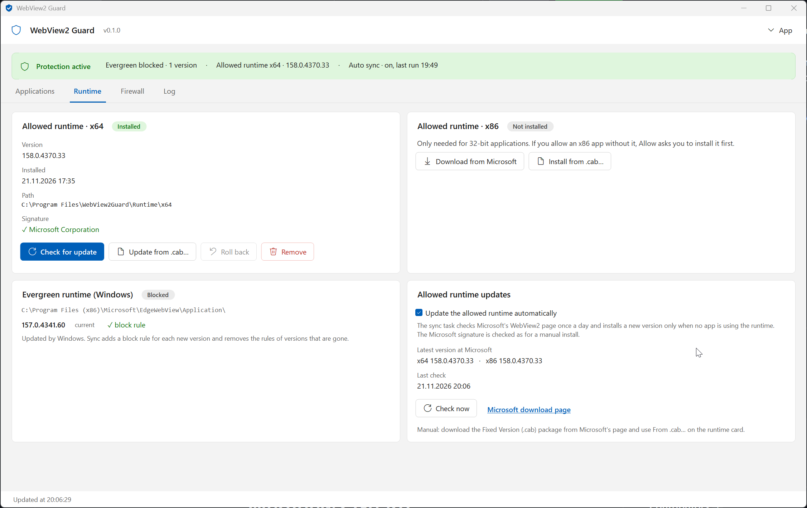

<div align="center">


# WebView2 Guard

**Decide which Windows apps may use WebView2 to reach the internet.**
Everything else that opens web content through Microsoft Edge WebView2 stays offline, including apps you have never seen.

[](LICENSE)
[](https://github.com/movidiu64/WebView2-Guard/actions/workflows/windows.yml)
[](https://github.com/movidiu64/WebView2-Guard/releases/latest)
[](https://github.com/movidiu64/WebView2-Guard/releases/latest)

[](https://buymeacoffee.com/ovidiu64)



</div>

Many desktop programs (Autodesk products, Office, Teams, Widgets…) show web pages and send data through the shared WebView2 runtime. A firewall rule on the program's own exe does not stop that traffic: it leaves through `msedgewebview2.exe`, from a folder whose name changes with every update. WebView2 Guard blocks the shared runtime in Windows Firewall and lets only the apps you approve go online, through a separate runtime of their own. It is for anyone who wants control over what their software sends, without blocking the programs themselves.

## Features

- 🛡️ **Blocked by default**: every version of the Evergreen runtime (the one Windows updates) gets an outbound block rule, kept current by a scheduled task that runs at startup and every hour, even when the window is closed.
- ✅ **Allow per app**: approved apps are routed to a Fixed Version runtime that has an allow rule, through Microsoft's official per-exe policy. You can split a product: allow the license sign-in, keep the start page offline.
- 🌐 **Allowed domains**: optionally limit an allowed app to a list of host names (`*.example.com` works); every other name fails to resolve.
- 🔎 **Sees who uses WebView2**: lists every app that starts the runtime, with its architecture, the runtime it is on and whether it must be restarted. New apps are flagged, and a notification-area icon can tell you about them as they appear.
- ⬇️ **Runtime from Microsoft**: install the Fixed runtime from a `.cab` you downloaded, or let the app download the newest one from Microsoft's page and keep it up to date. The Microsoft signature is checked before anything is replaced, and the previous version is kept for rollback.
- 🔥 **Its own firewall rules only**: everything lives in the `WebView2 Guard` group; works next to Malwarebytes Windows Firewall Control and other firewall tools.
- ↩️ **Reversible**: a `.reg` backup before every policy change, and *Uninstall everything* puts the system back as it was.
- 🌐 English and Romanian interface; updates itself from GitHub Releases, with SHA-256 checks.

## Quick start

1. Download from [Releases](https://github.com/movidiu64/WebView2-Guard/releases/latest): `WebView2Guard-win-x64-selfcontained.exe` runs anywhere; the smaller `WebView2Guard-win-x64.exe` needs the [.NET 10 Desktop Runtime](https://dotnet.microsoft.com/download/dotnet/10.0). Run it; it asks for administrator rights. Windows SmartScreen may warn about an unsigned app: choose **More info → Run anyway**.
2. **App → Install to Program Files**: copies the app, creates the sync task and adds the block rules.
3. **Runtime → Download from Microsoft** (or **Install from .cab…**) for the allowed x64 runtime.
4. **Applications**: start the programs you use; they show up in the list. Select one, click **Allow internet** and restart that program.

> [!TIP]
> Allow as little as possible, one exe at a time. For example, allow `AdskIdentityManager.exe` (Autodesk sign-in) and keep `acad.exe` (the AutoCAD start page) blocked, then check that the program still works for you.

## Documentation

The [guide](docs/guide.md) explains how it works, every tab, allowed domains, runtime updates, using it with Windows Firewall Control, the files it keeps, the command line and its limits. The [changelog](CHANGELOG.md) lists what changed in each version.

## Development

C# on .NET 10 with Windows Forms, one single-file exe with no dependencies besides `System.Management`. Requires Windows and the .NET 10 SDK.

```powershell
dotnet test tests/WebView2Guard.Tests        # unit tests
dotnet publish src/WebView2Guard/WebView2Guard.csproj -c Release -r win-x64 --self-contained false -p:PublishSingleFile=true
```

Every push runs the tests and builds both variants on Windows. A new version number on `main` publishes the release; see [Releasing](docs/guide.md#releasing).

## Support

WebView2 Guard is free and has no ads or telemetry. If it saves you time, you can [buy me a coffee](https://buymeacoffee.com/ovidiu64) ☕. Bug reports and ideas in [Issues](https://github.com/movidiu64/WebView2-Guard/issues) help just as much.

## Contributing

Issues and pull requests are welcome; please read [CONTRIBUTING.md](CONTRIBUTING.md) first, including the license terms for contributions.

## License

WebView2 Guard is free software under the [GNU General Public License v3.0](LICENSE). You can use, study, modify and share it freely. If you distribute it, modified or not, you must make the source code available under the same license.

© 2026 Ovidiu ([movidiu64](https://github.com/movidiu64))
